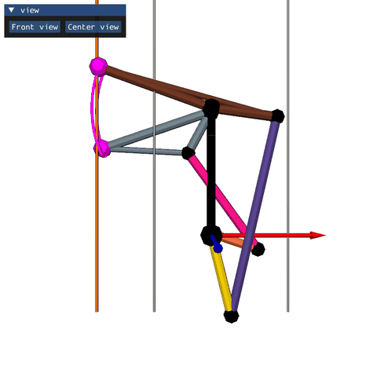
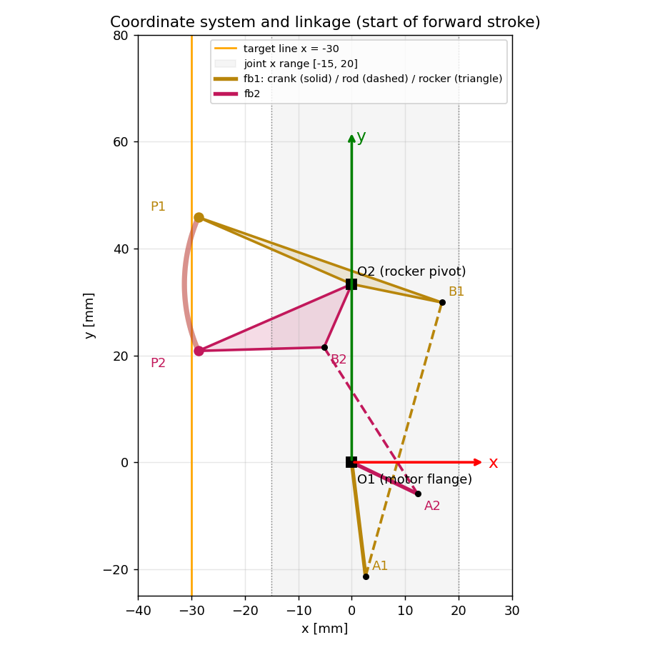
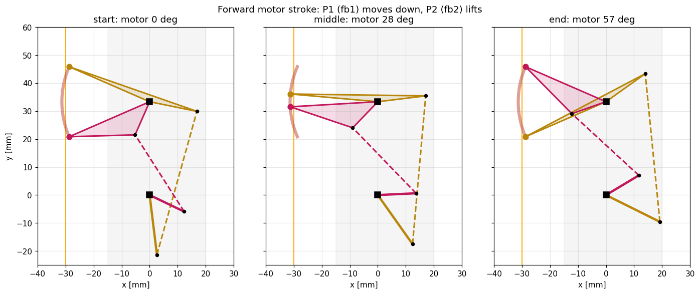
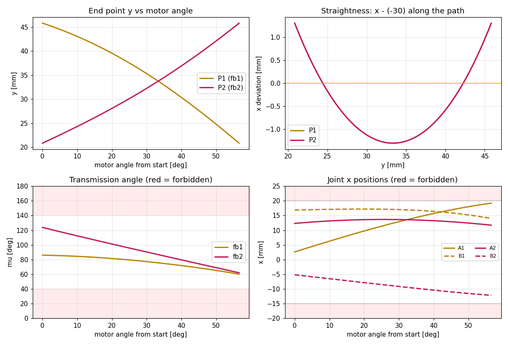
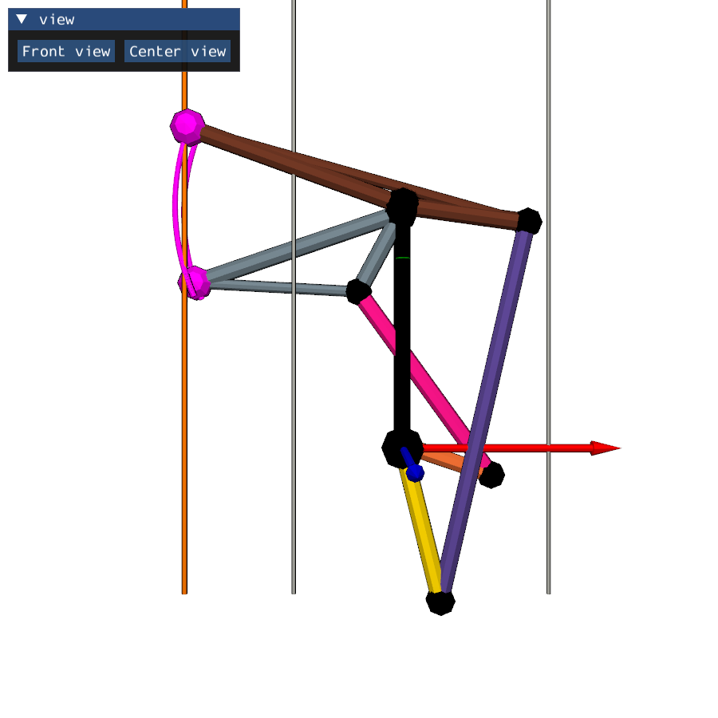

# pipette_4bar

[English](README.md) | **中文** | [日本語](README_ja.md)

单电机驱动的**双四杆机构**尺寸综合。两套四杆（fb1、fb2）共用同一个电机法兰，末端交替沿 x = -30 mm 的竖直线运动：一个向下时，另一个抬起。程序优化全部杆长和电机转角，并用 [`one`](https://github.com/wanweiwei07/wrs2) 库动画显示结果。



## 1. 坐标系与命名



| 符号 | 含义 |
|---|---|
| O1 = (0, 0) | 电机法兰轴，坐标原点。fb1 和 fb2 的 crank 都固定在它上面 |
| O2 = (0, f) | rocker 转轴，位于 +y 轴上（f = frame 长度） |
| A | crank 与 connecting rod 的铰接点 |
| B | connecting rod 与 rocker 的铰接点 |
| P | 末端（作用点），固连在 rocker 上（rocker 为三角形 O2-B-P） |
| fb1, fb2 | 两套四杆。fb2 的 crank 角 = fb1 的 crank 角 + δ（固定差，同一法兰） |

优化中单位为 mm，显示中单位为 m。

## 2. 设计要求

| 要求 | 数值 | 代码中的参数 |
|---|---|---|
| 末端沿竖直线运动 | x = -30 mm | `X_LINE` |
| 电机正向行程：fb1 末端沿 -y 移动 | ≥ 25 mm，单调 | `STROKE1` |
| 电机正向行程：fb2 末端抬起（+y） | ≥ 25 mm，单调 | `STROKE2` |
| fb2 末端起点相对 fb1 末端起点 | y₂ − y₁ = −25 mm | `START_OFFSET` |
| 电机反向行程 | 反过来：fb1 抬起，fb2 沿 -y | （自动满足） |
| 两个 crank 都指向 +x | 行程中 crank 端点 x ≥ 0 | `W_CRANK_DIR` |
| 转轴 A、B 的位置 | −15 ≤ x ≤ 20 mm | `JOINT_X_RANGE` |
| 传动角 | 40° ≤ μ ≤ 140° | `MU_MIN` |

## 3. 设计变量

每套四杆（×2）：`[f, a, b, c, p, β, σ]`

| 变量 | 含义 | 范围 |
|---|---|---|
| f | frame O1-O2 | 20 – 60 mm |
| a | crank O1-A | 10 – 30 mm |
| b | connecting rod A-B | 10 – 60 mm |
| c | rocker O2-B | 10 – 50 mm |
| p | O2 到 P 的距离 | 10 – 50 mm |
| β | O2B 到 O2P 的夹角 | −180° – 180° |
| σ | 装配分支 | ±1 |

共享变量：电机起始角 θ₀、crank 角度差 δ、电机转向（顺/逆时针）、电机行程角（45° – 180°）。

## 4. 方法

- **运动学**：对每个电机角，B 为圆(A, b) 与圆(O2, c) 在分支 σ 上的交点；P 由 O2B 旋转 β 并缩放到 p 得到。无法装配的构型直接淘汰。
- **代价函数**（fb1 与 fb2 求和）：直线度 max|x_P + 30|，加上非单调运动、行程不足、起点差误差、传动角、crank 方向、转轴 x 范围等罚项。
- **求解器**：`scipy.optimize.differential_evolution`（Sobol 初始化，多进程并行），一次约 10 秒。

## 5. 结果（seed = 0）

| | f | a | b | c | p | β | σ |
|---|---|---|---|---|---|---|---|
| fb1 | 33.34 | 21.48 | 53.16 | 17.21 | 31.30 | 168.0° | −1 |
| fb2 | 33.34 | 13.67 | 32.52 | 12.92 | 31.30 | −42.8° | +1 |

电机：起始角 −83.0°，逆时针转 56.6°；fb2 的 crank 角度差 δ = 57.4°。

| 项目 | fb1 | fb2 |
|---|---|---|
| 末端行程 | 45.84 → 20.84（−25.00 mm） | 20.84 → 45.84（+25.00 mm） |
| 最大 \|x − (−30)\| | 1.30 mm | 1.30 mm |
| 传动角 | 60.1° – 86.0° | 61.9° – 123.8° |
| 转轴 A 的 x | 2.60 – 19.23 mm | 11.72 – 13.67 mm |
| 转轴 B 的 x | 14.01 – 17.21 mm | −12.20 – −5.18 mm |





## 6. 注意事项

- **直线度的极限。** P 在 rocker 上，所以它的轨迹永远是以 O2 为圆心的圆弧。用圆弧逼近长度为 s 的直线段，最小偏差约为 s² / (16 p)：15 mm 时 0.47 mm，**25 mm 时 1.30 mm**，30 mm 时约 1.9 mm（估算）。其他变量无法减小这个误差；如需更直的轨迹，需要把 P 放到 connecting rod 上。
- **共用转轴。** 两个末端要在同一条线上覆盖同一段，所以最优解中 f₁ = f₂、p₁ = p₂：两个 rocker 共用转轴 O2，两个末端走同一段圆弧。它们必须放在不同平面（z 层）以免碰撞；显示中 fb2 画在 fb1 后方 6 mm。
- **多解。** 不同随机种子会得到代价相同但杆长不同的解。如需唯一设计，可加入次要目标（更小电机转角、更大传动角、更紧凑等）。

## 7. 使用方法

依赖：Python ≥ 3.12、`numpy`、`scipy`、[`one`](https://github.com/wanweiwei07/wrs2)（显示还需要 `pyglet` 和 `imgui-bundle`）。

```bash
# Windows 示例；让 `one` 可被导入
set PYTHONPATH=E:\src_code\one
py -3.12 four_bar_opt.py
```

程序会打印结果（见第 5 节），保存到 `four_bar_result.npy`，并打开显示窗口：



| 界面元素 | 含义 |
|---|---|
| 金 / 紫 / 棕 | fb1 的 crank / connecting rod / rocker |
| 胡萝卜橙 / 粉 / 石板灰 | fb2 的 crank / connecting rod / rocker |
| 黑色 | frame 和铰接点 |
| 品红 | 末端 P 及其轨迹 |
| 橙色线 | 目标线 x = −30 |
| 银灰线 | 转轴 x 范围 −15 和 20 |
| **Front view** 按钮 | 正视图：沿 −z 看 xy 平面，y 朝上，自动缩放到整个机构 |
| **Center view** 按钮 | 居中视图：保持当前视角方向，重新居中并缩放 |

电机在行程内来回摆动。鼠标：左键/右键拖动旋转，中键拖动平移，滚轮缩放。

修改要求时，编辑 [four_bar_opt.py](four_bar_opt.py) 顶部的常量（`X_LINE`、`STROKE1`、`STROKE2`、`START_OFFSET`、`JOINT_X_RANGE`、`MU_MIN`、`FB_BOUNDS` 等）。不重新优化、直接回放已保存的结果：

```python
import numpy as np, four_bar_opt as m
x = np.load("four_bar_result.npy")
m.report(x)
m.visualize(x)
```

> 在 Windows 上优化器使用多进程（`workers=-1`）。任何调用 `optimize()` 的脚本都必须放在 `if __name__ == '__main__':` 下，否则每个子进程都会重新运行整个脚本。
